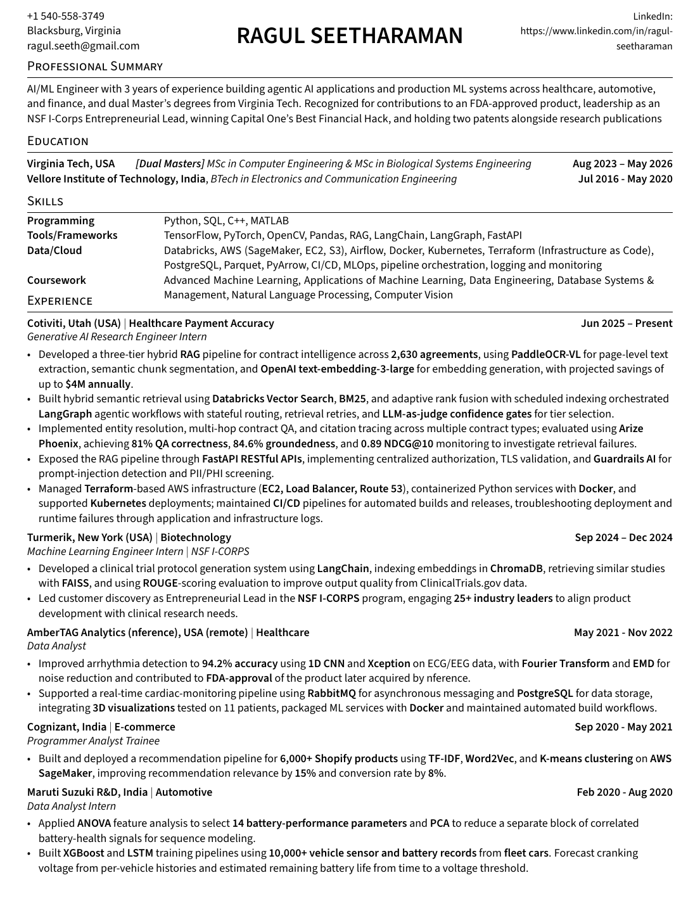
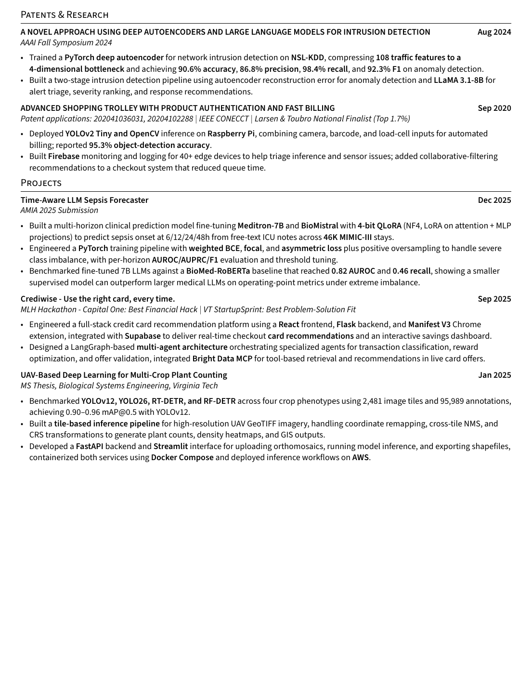

# Hi, I'm Ragul Seetharaman

I'm an AI/ML engineer with a dual Master's from **Virginia Tech** (Computer Engineering and Biological Systems Engineering). For the past three years I've built agentic AI applications and production ML systems in healthcare, automotive, and finance. I'm currently a Generative AI Research Engineer intern at Cotiviti, working on contract intelligence for healthcare payment accuracy.

My work started with signal processing and classical ML on cardiac data, moved through clinical NLP and LLM fine-tuning, and now sits mostly in retrieval, agent orchestration, and evaluation. Across all of it, the question I keep coming back to is how you actually know a model is right, and what you do when it isn't.

---

## What I'm up to right now

- **Contract intelligence at Cotiviti.** I build and evaluate a hybrid RAG system over 2,630 contracts and meet with customer stakeholders every week.
- **PALE (Personal Agents' Last Exam).** Early contributor to an open-source benchmark for personal agents on long-horizon, multi-session, cross-domain tasks, scored on environment state instead of transcript text. I'm just starting, so the notes below are the design problems I'm working through, not shipped results.

### PALE: design notes

**Environment formulation**
- Each task as a POMDP. The agent observes only dialogue and tool returns, never the full world state.
- LLM user simulator with hidden intents and persona-conditioned preferences. Its actions are grounded in the environment (τ²-bench style dual control) so simulator drift doesn't leak into the score.
- Compositional task generation from atomic primitives: a preference fact, a hard constraint, an exogenous event (product recall, gate change), and a tool side effect. Dependency depth and difficulty stay controllable and every task stays programmatically verifiable.

**Long-term memory and cross-session state**
- Seeded multi-session histories where the gold action depends on a fact introduced N sessions earlier, sweeping dependency distance and distractor density.
- Knowledge-update probes. Facts carry bi-temporal validity (`valid_at` / `invalid_at`), and the check is whether the agent acts on the currently valid fact instead of the most retrieved or most recent mention.
- Temporal grounding: resolving relative references ("the week after the move") against session timestamps.
- Oracle-memory ablation that injects gold evidence into context. This separates retrieval failure from utilization failure, so a miss can be attributed to the memory layer or to reasoning.
- Memory integrity. Adversarial writes through query-only memory injection (MINJA style) and indirect prompt injection in tool outputs, then tracing whether poisoned records propagate into later actions.

**Privacy, consent, and delegated authority**
- Contextual-integrity labels on every information flow (sender, recipient, data subject, attribute, transmission principle). Leakage is scored across the full trajectory, including intermediate tool calls, not just the final message.
- Authorization-scope checks. Irreversible or high-stakes actions (purchases, cancellations, sharing health data with a caregiver) need explicit consent. Acting outside delegated scope fails the task even when the end state matches.

**Proactivity and abstention**
- Hidden-intent tasks where the correct policy is act, defer, or ask. Acting under unresolved ambiguity and redundant clarification (asking for something already supplied) are both penalized.
- Calibrated abstention when evidence is missing or contradictory, treated as a decision outcome, not a span match.

**Scoring and reliability**
- Final-state diff against an annotated goal state, plus action-level assertions for side effects and constraint violations.
- pass^k over i.i.d. trials to measure consistency, since pass@1 hides run-to-run variance.
- LLM-as-judge only where outcomes aren't deterministic (clarification quality, tone), using binary rubric checklists and validated against human labels with Cohen's κ before the judge is trusted.
- Failure taxonomy per trajectory: retrieval miss, stale-fact use, utilization error, policy violation, privacy leak, premature action.

---

## Resume

[Download the PDF](assets/Ragul_Seetharaman_AI_Resume.pdf)

---

## What I work on

### Agentic RAG and LLM systems
- Three-tier hybrid RAG for contract QA: PaddleOCR-VL for page-level text extraction, semantic chunking, OpenAI `text-embedding-3-large` embeddings, and retrieval that mixes Databricks Vector Search with BM25 using adaptive rank fusion.
- LangGraph workflows with stateful routing, retrieval retries, and LLM-as-judge confidence gates that decide which tier answers a question.
- Entity resolution, multi-hop contract QA, and citation tracing across Master Service Agreements, Statements of Work, Amendments, Work Orders, and clause-level references.
- Evaluation suite in Arize Phoenix on a curated contract-QA set: 81% QA correctness, 84.6% groundedness, 0.89 NDCG@10.
- Served through FastAPI with centralized authorization, TLS validation, and Guardrails AI for prompt-injection and jailbreak detection and PII/PHI screening.
- Multi-agent design with LangGraph for card recommendations in Crediwise: separate agents for transaction classification, reward optimization, and offer validation, with Bright Data MCP for live offer retrieval. I'm adding RAG retrieval on top to cut hallucinations in the scraped offers.

### LLM fine-tuning and clinical NLP
- Fine-tuned Meditron-7B and BioMistral with 4-bit QLoRA (NF4, LoRA on attention and MLP projections) to predict sepsis onset at 6, 12, 24, and 48 hours from free-text ICU notes across 46K MIMIC-III stays.
- Handled heavy class imbalance with weighted BCE, focal loss, asymmetric loss, and positive oversampling, with per-horizon AUROC, AUPRC, and F1 and threshold tuning.
- A much smaller BioMed-RoBERTa baseline reached 0.82 AUROC and 0.46 recall and did better than the 7B models on operating-point metrics. That result changed how I pick models: I start from the small supervised baseline and make the larger model earn its cost.

### Signal processing and biomedical AI
- Arrhythmia detection on ECG and EEG with a 1D CNN and Xception, reaching 94.2% accuracy. Used Fourier Transform and empirical mode decomposition (EMD) to reduce noise.
- Part of the team behind a cardiac monitoring product that received FDA approval and was later acquired by nference. Supported the real-time pipeline with RabbitMQ for async messaging and PostgreSQL for storage, plus 3D visualizations tested on 11 patients.
- Earlier, built a BiLSTM that maps protein sequences to EC numbers, trained on 70K sequences from UniProt and Rhea.

### Computer vision and edge ML
- Thesis work: benchmarked YOLOv12, YOLO26, RT-DETR, and RF-DETR on four crop phenotypes (2,481 image tiles, 95,989 annotations), reaching 0.90 to 0.96 mAP@0.5 with YOLOv12.
- Built tile-based inference for high-resolution UAV GeoTIFFs: coordinate remapping, cross-tile NMS, and CRS transformations, producing plant counts, density heatmaps, and shapefiles.
- Patented smart trolley: YOLOv2 Tiny and OpenCV on a Raspberry Pi, combining camera, barcode, and load-cell inputs for automated billing (95.3% detection accuracy). A Firebase admin interface monitors 40+ trolleys, and collaborative filtering recommendations cut checkout queue time by 8 minutes.

### Infrastructure and MLOps
- Terraform-managed AWS (EC2, Load Balancer, Route 53), Docker for Python services, Kubernetes deployments, and CI/CD for automated builds and releases.
- Debugging deployment and runtime failures from application and infrastructure logs.
- Pipeline tooling: Databricks, Airflow, Parquet and PyArrow, PostgreSQL, SageMaker.

---

## Experience

**Cotiviti** | Generative AI Research Engineer Intern | Jun 2025 to present
Hybrid RAG and agentic workflows for contract intelligence in healthcare payment accuracy. Projected savings of up to $4M a year. Stack: LangGraph, Databricks Vector Search, BM25, PaddleOCR-VL, FastAPI, Arize Phoenix, Guardrails AI, Terraform, Docker, Kubernetes.

**Turmerik** | Machine Learning Engineer Intern, NSF I-Corps | Sep 2024 to Dec 2024
Built a clinical trial protocol generator on ClinicalTrials.gov data using LangChain, ChromaDB for embeddings, FAISS for similar-study retrieval, and ROUGE scoring to tune output quality. As Entrepreneurial Lead, ran customer discovery with 25+ industry leaders.

**AmberTAG Analytics (nference)** | Data Analyst | May 2021 to Nov 2022
Arrhythmia detection models and a real-time cardiac monitoring pipeline for a product that went on to FDA approval.

**Cognizant** | Programmer Analyst Trainee | Sep 2020 to May 2021
Recommendation pipeline for 6,000+ Shopify products using TF-IDF, Word2Vec, and K-means on AWS SageMaker. Relevance went up 15% and conversion up 8%.

**Maruti Suzuki R&D** | Data Analyst Intern | Feb 2020 to Aug 2020
Battery health forecasting on 10,000+ fleet vehicle records. ANOVA to pick 14 battery parameters, PCA on correlated health signals, and XGBoost and LSTM models that forecast cranking voltage and estimate remaining battery life.

---

## Featured projects

| Project | What it is | Stack |
|---|---|---|
| **Time-Aware LLM Sepsis Forecaster** | Multi-horizon sepsis onset prediction from ICU notes, benchmarked against a smaller supervised baseline | PyTorch, QLoRA, Meditron-7B, BioMistral, MIMIC-III |
| **Crediwise** | Chrome extension that recommends the best credit card at checkout, with a savings dashboard. Capital One Best Financial Hack at an MLH hackathon, Best Problem-Solution Fit at VT StartupSprint | React, Flask, Manifest V3, Supabase, LangGraph, Bright Data MCP |
| **UAV Multi-Crop Plant Counting** | MS thesis. Detection benchmark plus a web app where you upload an orthomosaic and export shapefiles | YOLOv12, RT-DETR, RF-DETR, FastAPI, Streamlit, Docker Compose, AWS |
| **Clinical Trial Protocol Generator** | Retrieval-based generation of trial protocols from similar past studies | LangChain, ChromaDB, FAISS, ROUGE |
| **Smart Trolley (Zenkart)** | Patented self-checkout cart with product authentication | YOLOv2 Tiny, OpenCV, Raspberry Pi, Firebase |

---

## Research and patents

- **AAAI Fall Symposium 2024:** two-stage network intrusion detection. A PyTorch deep autoencoder trained on NSL-KDD compresses 108 traffic features into a 4-dimensional bottleneck and flags anomalies by reconstruction error. LLaMA 3.1-8B then triages alerts, ranks severity, and suggests responses.
- **Patents:** Advanced Shopping Trolley with Product Authentication and Fast Billing (applications 202041036031 and 20204102288). IEEE CONECCT, Larsen & Toubro national finalist (top 1.7%).
- **AMIA 2025 submission:** the sepsis forecasting work above.

---

## Tech stack

| Layer | Tools |
|---|---|
| **Languages** | Python, SQL, Cypher, C++, MATLAB |
| **Agents and orchestration** | LangGraph (stateful graphs, conditional routing, checkpointed state), LangChain, Model Context Protocol (MCP), Bright Data MCP, multi-agent orchestrator and sub-agent patterns |
| **LLMs** | OpenAI GPT models, LLaMA 3.1-8B, Meditron-7B, BioMistral, BioMed-RoBERTa |
| **Fine-tuning** | PyTorch, Hugging Face Transformers, PEFT (LoRA, QLoRA), bitsandbytes 4-bit NF4 quantization, focal and asymmetric loss for class imbalance |
| **Retrieval and embeddings** | Databricks Vector Search, FAISS, ChromaDB, BM25, reciprocal and adaptive rank fusion, OpenAI `text-embedding-3-large`, semantic chunking, PaddleOCR-VL for document parsing |
| **Graph and agent memory** | Neo4j, Cypher, knowledge graph construction (entity and relation extraction, entity resolution), temporal knowledge graphs with bi-temporal edges (Graphiti), GraphRAG, hybrid graph plus vector retrieval |
| **Evaluation and guardrails** | Arize Phoenix (QA correctness, groundedness, NDCG@k), LLM-as-judge, ROUGE, pass^k, Guardrails AI (prompt injection, jailbreak, PII/PHI screening) |
| **Computer vision** | YOLOv12, YOLO26, RT-DETR, RF-DETR, Xception, 1D CNNs, OpenCV, GeoTIFF tiling with cross-tile NMS and CRS transforms |
| **Backend and apps** | FastAPI, Flask, Streamlit, React, Chrome Extensions (Manifest V3), Supabase, Firebase, RabbitMQ |
| **Data engineering** | Databricks, Apache Airflow, PostgreSQL, Parquet, PyArrow, Pandas |
| **Cloud and infra** | AWS (SageMaker, EC2, S3, Elastic Load Balancing, Route 53), Terraform, Docker, Docker Compose, Kubernetes, CI/CD |
| **Edge** | Raspberry Pi, load cells, barcode scanners, YOLOv2 Tiny |

---

## Let's connect

- [LinkedIn](https://www.linkedin.com/in/ragul-seetharaman/)
- [Email](mailto:ragul.seeth@gmail.com)
